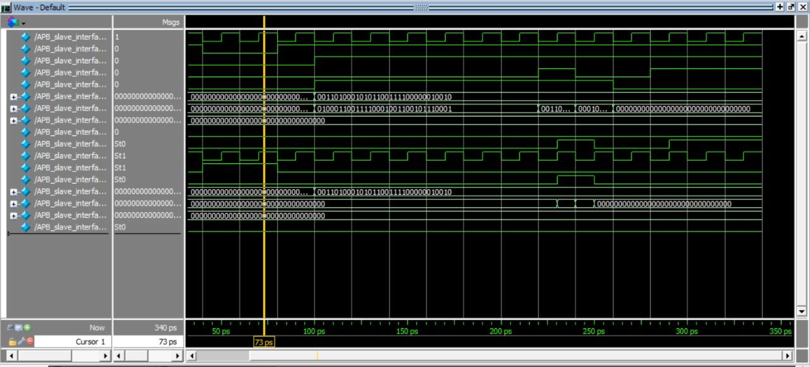
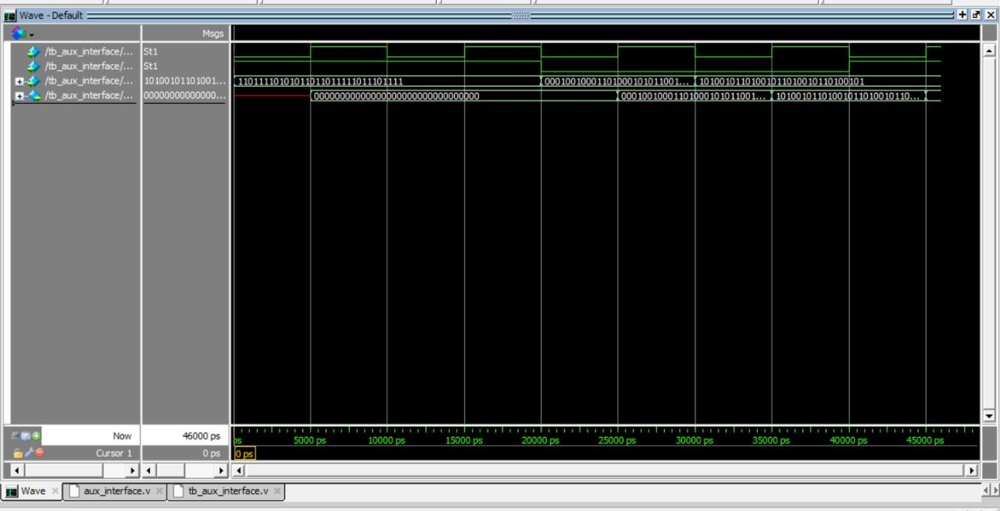
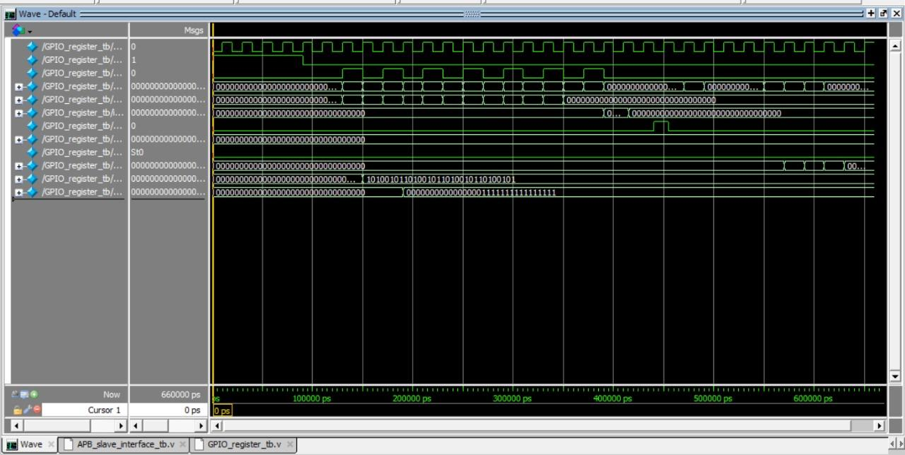
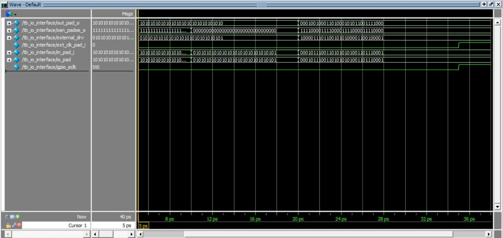
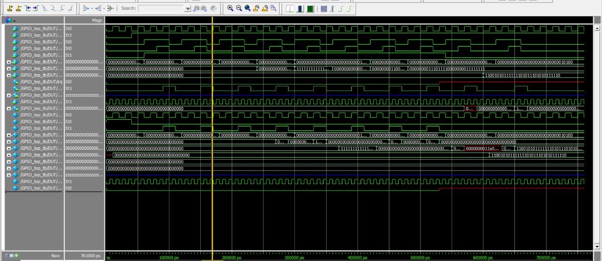

# APB-Interfaced GPIO IP Core (Verilog)

A 32-pin General-Purpose Input/Output (GPIO) block written in Verilog. It connects to a processor through an **APB (AMBA 3) slave interface**, so software controls the pins by reading and writing memory-mapped registers. Each pin can be an input or an output, can be driven by an auxiliary on-chip signal instead of software, and can raise an interrupt on an edge.

## What is in the design

| Block | File | Module | Job |
|---|---|---|---|
| APB slave interface | `rtl/APB_slave.v` | `APB_slave_interface` | Three-state APB protocol machine (IDLE, SETUP, ACCESS). Turns APB transfers into register reads and writes. |
| GPIO registers | `rtl/gpio_register.v` | `GPIO_register` | The ten registers, input sampling, edge detection, interrupt, and the output multiplexer. |
| AUX interface | `rtl/aux_interface.v` | `aux_interface` | Registers the 32-bit auxiliary input before it reaches the output multiplexer. |
| IO interface | `rtl/IO_interface.v` | `io_interface` | One tri-state buffer per pin on a 32-bit bidirectional pad bus. |
| Top | `rtl/gpio_top.v` | `GPIO_top` | Connects the four blocks. |

## How it works

1. The APB master starts a transfer. The slave interface moves from IDLE to SETUP when `PSEL` is high and `PENABLE` is low, then to ACCESS when `PENABLE` goes high.
2. In ACCESS, a write puts `PWDATA` on the register bus with the write enable high. A read returns the selected register on `PRDATA`. `PREADY` is high while the slave is in ACCESS.
3. The register block decodes the address (`0x00` to `0x24`) and updates or returns the matching register.
4. In the register block, each output pin carries either its `RGPIO_OUT` bit or its auxiliary input bit, chosen per pin by `RGPIO_AUX`.
5. In the register block, input pins are sampled into `RGPIO_IN` on the system clock, or on an external clock if the pin's `RGPIO_ECLK` bit is set.
6. If interrupts are enabled, a change on an enabled input pin sets that pin's bit in `RGPIO_INTS` and raises `irq`.

## Register map

All registers are 32 bits wide except `RGPIO_CTRL`, and every register resets to 0.

| Register | Address | Access | Function as implemented |
|---|---|---|---|
| `RGPIO_IN` | `0x00` | Read | Current input value of each pin (latched on the system clock or the external clock). |
| `RGPIO_OUT` | `0x04` | Read/Write | Output value of each pin when its AUX bit is 0. |
| `RGPIO_OE` | `0x08` | Read/Write | Output control. A bit of **0 drives the pin**; a bit of **1 leaves the pin high impedance**. |
| `RGPIO_INTE` | `0x0C` | Read/Write | Per-pin interrupt enable (1 = enabled). |
| `RGPIO_PTRIG` | `0x10` | Read/Write | Per-pin edge polarity. 1 detects a rising edge, 0 detects a falling edge. |
| `RGPIO_AUX` | `0x14` | Read/Write | Per-pin output source. 0 = `RGPIO_OUT`, 1 = auxiliary input. |
| `RGPIO_CTRL` | `0x18` | Read/Write | 2 bits. Bit 0 = global interrupt enable. Bit 1 = interrupt status flag. |
| `RGPIO_INTS` | `0x1C` | Read/Write | Per-pin interrupt status. Bits are set by detected edges. Software clears a bit by writing 0 to it. |
| `RGPIO_ECLK` | `0x20` | Read/Write | Per-pin input clock select. 0 = system clock, 1 = external clock. |
| `RGPIO_NEC` | `0x24` | Read/Write | Per-pin external clock edge. 0 = rising edge, 1 = falling edge. |

Output pin value: `out_pad_o = (RGPIO_OUT & ~RGPIO_AUX) | (aux_i & RGPIO_AUX)`.

Interrupt output: `irq` is high when any bit of `RGPIO_INTS` is set and `RGPIO_CTRL[0]` is 1. An edge sets a bit only when the pin's `RGPIO_INTE` bit is 1.

## Simulation

Tool: ModelSim. Each testbench in `tb/` has its own top module.

| Testbench | Top module | Tests |
|---|---|---|
| `tb/APB_slave_tb.v` | `tb_APB_slave_interface` | APB state machine, write enable, read data |
| `tb/aux_interface_tb.v` | `aux_interface_tb` | Auxiliary register |
| `tb/gpio_register_tb.v` | `GPIO_register_tb` | Writes random values to every register, then reads them back |
| `tb/io_interface_tb.v` | `tb_io_interface` | Tri-state pad logic |
| `tb/gpio_top_tb.v` | `GPIO_top_tb` | Whole core through the APB bus |

To run one, from the repo folder:

```
vlog rtl/*.v tb/gpio_top_tb.v
vsim -voptargs=+acc work.GPIO_top_tb
add wave -r /*
run -all
```

Replace `gpio_top_tb.v` and `GPIO_top_tb` with another row of the table to run that testbench. The testbenches apply directed stimulus and are checked by reading the waveforms. They have no automatic pass/fail check.

### Waveforms

ModelSim waveforms captured during the internship.











## Folder structure

```
.
├── README.md
├── rtl/
│   ├── APB_slave.v
│   ├── aux_interface.v
│   ├── gpio_register.v
│   ├── IO_interface.v
│   └── gpio_top.v
├── tb/
│   ├── APB_slave_tb.v
│   ├── aux_interface_tb.v
│   ├── gpio_register_tb.v
│   ├── io_interface_tb.v
│   └── gpio_top_tb.v
└── docs/
    └── waveforms/        # ModelSim screenshots
```
